<!--
  BILAL BAKESSOU — HISOKA PROFILE V3 / DARK NEON PORTFOLIO
  Designed for github.com/hisokaBK/hisokaBK
  All local media in /assets must be committed with this README.
  GitHub-safe HTML + Markdown only: no JavaScript, iframes, CSS or traditional tables.
  Project covers are stylized illustrations (not screenshots of the apps).
-->

  
  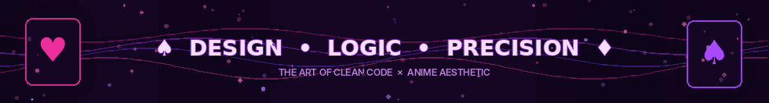

   

  

   

  
  
  
    
  
  
♠ STRATEGY &nbsp;&nbsp; ♥ CREATIVITY &nbsp;&nbsp; ♦ PRECISION &nbsp;&nbsp; ♣ DISCIPLINE

 

  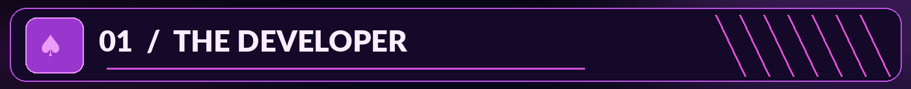

### ♠ Bilal Bakessou

**Full-Stack Web Developer** · Backend-oriented · 🇲🇦 Morocco

I build web applications, REST APIs and backend systems where **clear architecture, maintainability and useful features** matter more than unnecessary complexity.

My background combines **PHP / Laravel**, **JavaScript / TypeScript**, **React / Vue.js**, **Python** and SQL/NoSQL databases. I enjoy understanding how systems work underneath, from custom MVC patterns and database layers to API integration and Dockerized environments.

**Currently exploring:** better software architecture, data workflows, testing and end-to-end product development.

**Open to:** internships, pre-employment internships and developer opportunities.

> *“Every line of code deserves a purpose.”* 🃏

 

  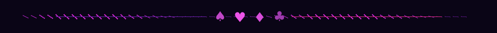

 

  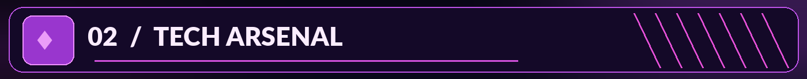
  
Tools I have worked with across web development, backend systems and data projects.

  <h3>♠ Languages & Web Fundamentals</h3>
  

  <h3>♥ Frameworks & Frontend</h3>
  

  <h3>♦ Databases & Data</h3>
  
   
  
  
  

  <h3>♣ API Design, Documentation & Testing</h3>
  
  
  
  

  <h3>🃏 Dev Tools & Workflow</h3>
  
   
  
  
  
  
  
  
    
  Also working with: MVC · OOP · PDO · PSR-4 · Git workflows · authentication & authorization · database modeling.

 

  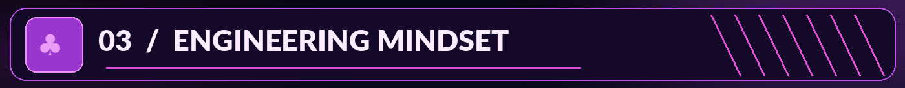
  
Not a traditional skills table — a visual map of how I approach software.

  

 

  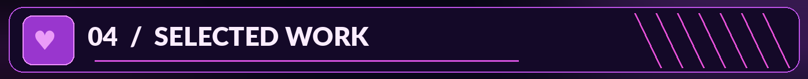
  
<i>Four repositories. Four different engineering challenges. Click any cover to explore the code.</i>

  
    

  <a href="https://github.com/hisokaBK/Colocation-EasyColoc">
    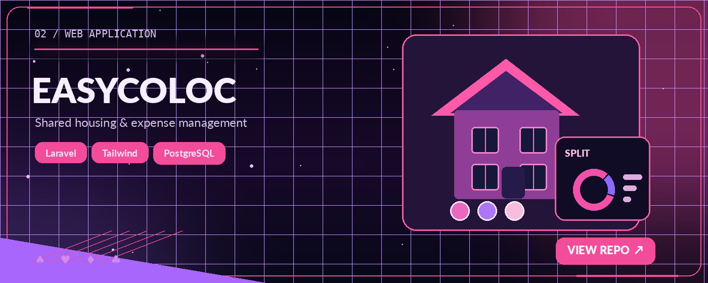
  </a>
    

  <a href="https://github.com/hisokaBK/PHP-ORM">
    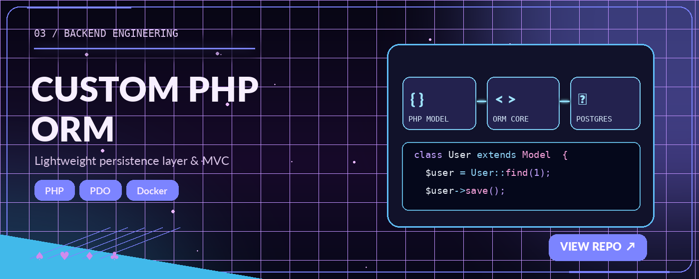
  </a>
    

  <a href="https://github.com/hisokaBK/EcoShop_API">
    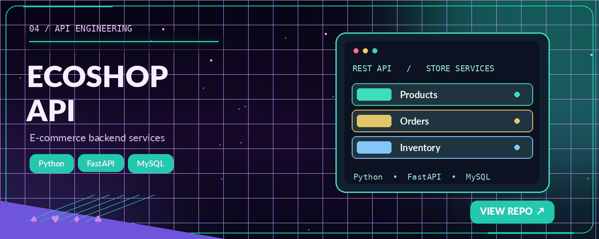
  </a>
   

  Project art is illustrative — select a cover to see each repository's real code.

 

  
   
  

 

  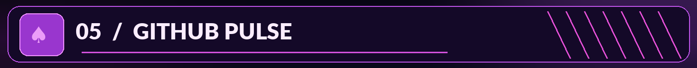
  
Public repository statistics are live and may change over time.

  
  
   
  
   
  

 

  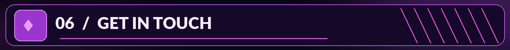
  
Have a development project, internship or collaboration in mind? Let's connect.

  
  
  
  
  

    
  
   
  

