<!--
  Bilal Bakessou — professional GitHub profile, 2026.
  Original visual system. Section animations are real, optimized GIFs; static fallbacks
  are provided for visitors who prefer reduced motion. Project illustrations are
  conceptual artwork (not app screenshots). Photos are supplied by the profile owner.
-->

  <picture>
    <source media="(prefers-reduced-motion: reduce)" srcset="./assets/static/hero.webp" />
    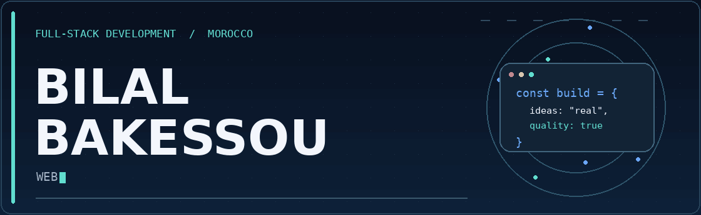
  </picture>

  
<strong>Full-Stack Web Development &nbsp;•&nbsp; Backend & APIs &nbsp;•&nbsp; Data</strong>

  

    
    
    
    
  

  Morocco · Interested in junior roles, internships and meaningful collaborations
    
  

    <a href="#about">About</a> ·
    <a href="#work">Projects</a> ·
    <a href="#stack">Stack</a> ·
    <a href="#experience">Experience</a> ·
    <a href="#education">Education</a> ·
    <a href="#community">Beyond code</a> ·
    <a href="#contact">Contact</a>
  

---

<picture><source media="(prefers-reduced-motion: reduce)" srcset="./assets/static/about.webp" />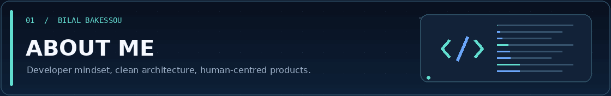</picture>

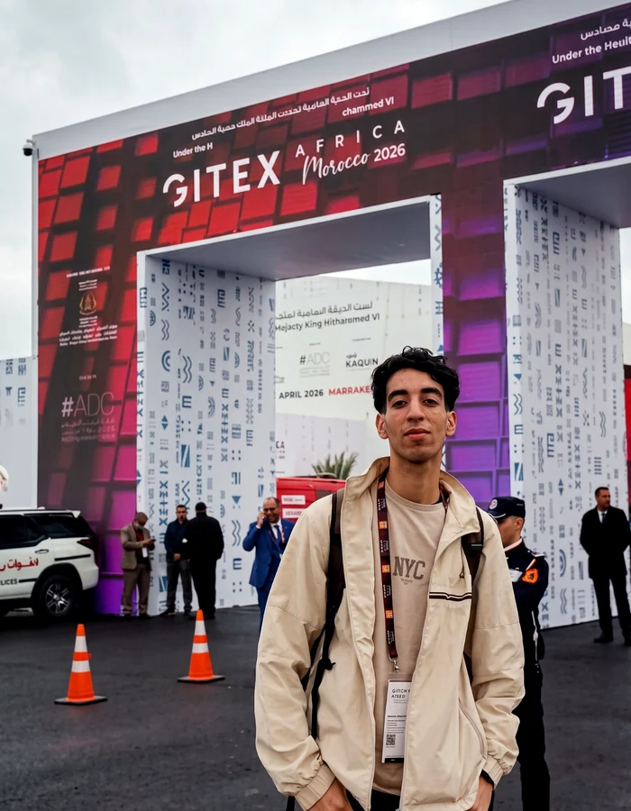

I'm **Bilal Bakessou**, a developer from Morocco. I build web products from **frontend interfaces** through **backend APIs and databases** and explore practical **data engineering**.

I work primarily with **React, TypeScript, JavaScript, PHP/Laravel, Python and SQL**. My public projects include real-time applications, e-commerce APIs, responsive interfaces and automated data workflows.

I like software that is **useful, maintainable and thoughtfully designed**, with clean architecture, good accessibility and a solid experience across devices.

**Current focus:** junior developer roles, internships and *stages pré-embauche* in full-stack development, backend or data. I am available for opportunities in **Marrakech and Tangier**.

[Discover the full portfolio](https://potfolio-bilal-bakessou.vercel.app/) · [Explore all repositories](https://github.com/hisokaBK?tab=repositories)

 
 

<picture><source media="(prefers-reduced-motion: reduce)" srcset="./assets/static/projects.webp" />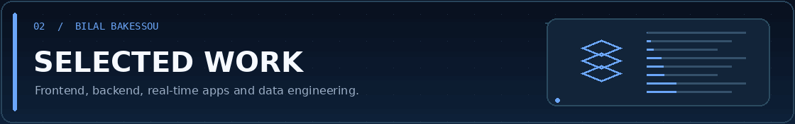</picture>

Six projects, six different problems. The covers are **custom illustrations**; select a project to open its real repository and documentation.

<a href="https://github.com/hisokaBK/PharmaClick">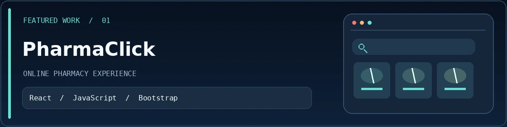</a>

**PharmaClick** — a responsive online pharmacy storefront focusing on product discovery, category filtering and an intuitive shopping experience.  
**Stack:** React · JavaScript · Bootstrap · CSS  
[**Live demo**](https://pharma-click.netlify.app/) · [Source code](https://github.com/hisokaBK/PharmaClick)

<a href="https://github.com/hisokaBK/Streaming_Platform">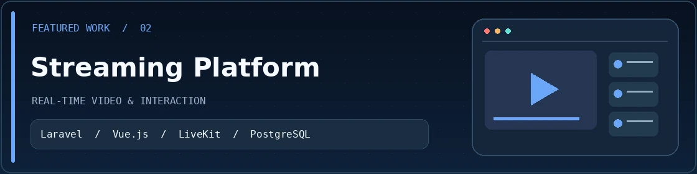</a>

**Streaming Platform** — a full-stack project for live video, replay workflows, profiles and real-time audience interaction.  
**Stack:** Laravel · Vue.js · LiveKit · PostgreSQL · Docker  
[Source code](https://github.com/hisokaBK/Streaming_Platform)

<a href="https://github.com/hisokaBK/EcoShop_API">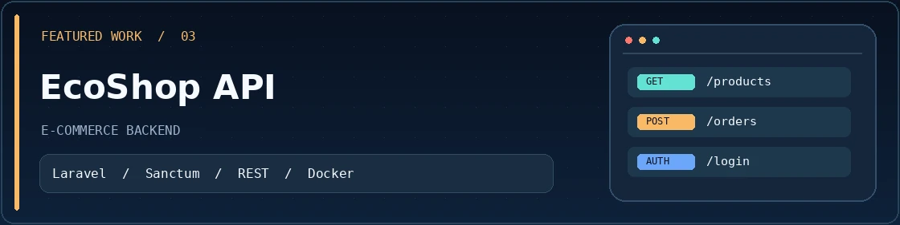</a>

**EcoShop API** — an e-commerce backend with authentication, role-based access, products, carts and orders.  
**Stack:** PHP · Laravel · Laravel Sanctum · REST · Docker  
[Source code](https://github.com/hisokaBK/EcoShop_API)

<a href="https://github.com/hisokaBK/pipeline-de-donnees">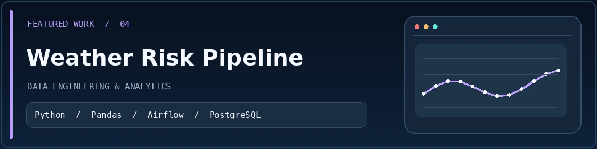</a>

**Weather Risk Pipeline** — data ingestion, cleaning and weather-risk analysis to help with logistics planning.  
**Stack:** Python · Pandas · Apache Airflow · PostgreSQL · Streamlit  
[Source code](https://github.com/hisokaBK/pipeline-de-donnees)

<a href="https://github.com/hisokaBK/Colocation-EasyColoc">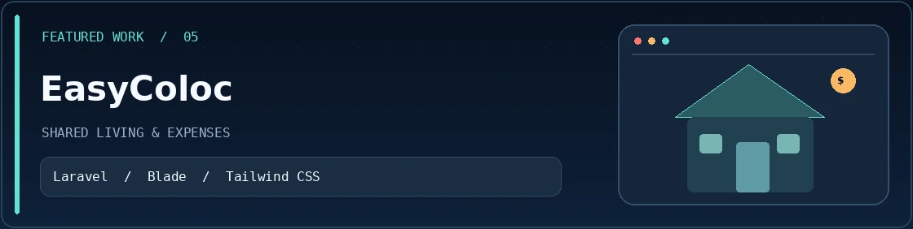</a>

**EasyColoc** — a web app for shared housing groups, member invitations, expenses and balances.  
**Stack:** PHP · Laravel · Blade · Tailwind CSS · Docker  
[Source code](https://github.com/hisokaBK/Colocation-EasyColoc)

<a href="https://github.com/hisokaBK/PHP-ORM">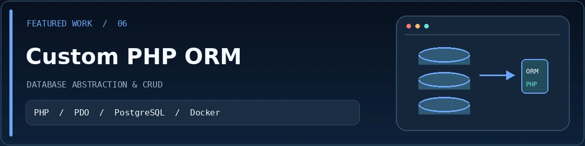</a>

**Custom PHP ORM** — a lightweight PDO-based ORM with MVC CRUD flows, PostgreSQL and containerized development.  
**Stack:** PHP · PDO · PostgreSQL · Docker · Nginx  
[Source code](https://github.com/hisokaBK/PHP-ORM)

Also see my separate <a href="https://github.com/hisokaBK/potfolio">React + TypeScript portfolio application</a> — <a href="https://potfolio-bilal-bakessou.vercel.app/">live website</a>.

 

<picture><source media="(prefers-reduced-motion: reduce)" srcset="./assets/static/skills.webp" />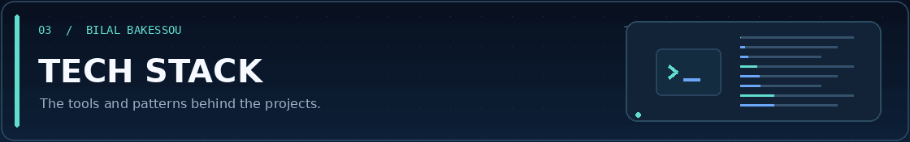</picture>

  

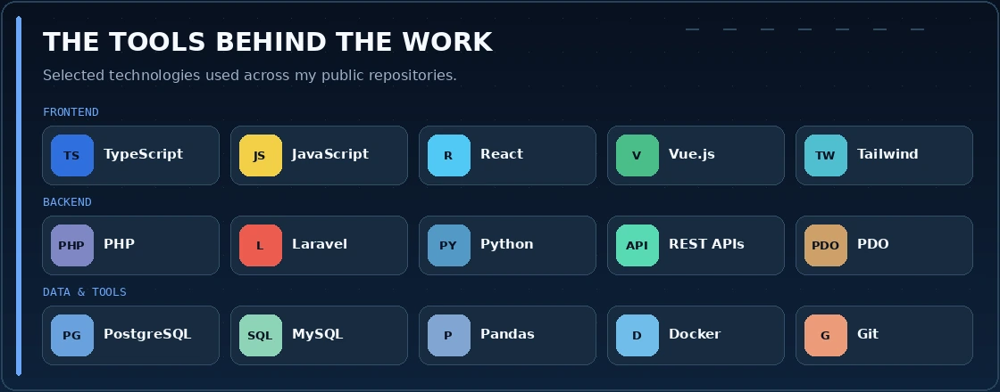

| Area | Skills and tools |
| :--- | :--- |
| **Frontend** | React, Vue.js, TypeScript, JavaScript, HTML, CSS, Tailwind CSS, Bootstrap |
| **Backend & architecture** | PHP, Laravel, Python, REST APIs, MVC, OOP, authentication, PDO |
| **Databases & data** | PostgreSQL, MySQL/MariaDB, MongoDB, Pandas, ETL pipelines |
| **Delivery & tooling** | Git, GitHub, Docker, Postman, Linux, VS Code |

<picture><source media="(prefers-reduced-motion: reduce)" srcset="./assets/static/experience.webp" />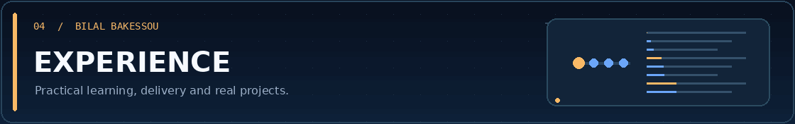</picture>

### Web Development Intern · Logic Technologies MA
**May – July 2026** · Morocco  
Three-month internship gaining professional experience in web development and software delivery.

### Project-based development · YouCode (UM6P)
**2025 – 2026**  
Hands-on full-stack and data projects, including API design, backend systems, responsive UIs and deployment workflows.

<picture><source media="(prefers-reduced-motion: reduce)" srcset="./assets/static/education.webp" />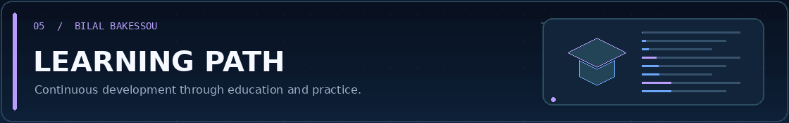</picture>

**YouCode (UM6P)** — Full-Stack Web Development & Data (2025–2026)  
**OFPPT** — Technicien Spécialisé en Développement Digital (Bac+2)  
**Faculté des Sciences Moulay Ismaïl, Meknès** — University studies  
**Baccalauréat SVT** — 2020

<picture><source media="(prefers-reduced-motion: reduce)" srcset="./assets/static/community.webp" />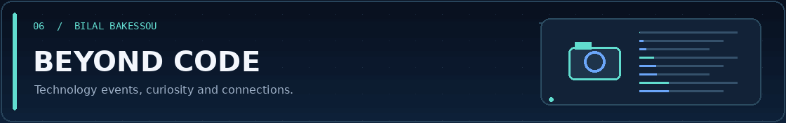</picture>

I enjoy discovering new technologies, meeting people around innovation and exploring places outside the screen. Here are a few moments that matter to me.

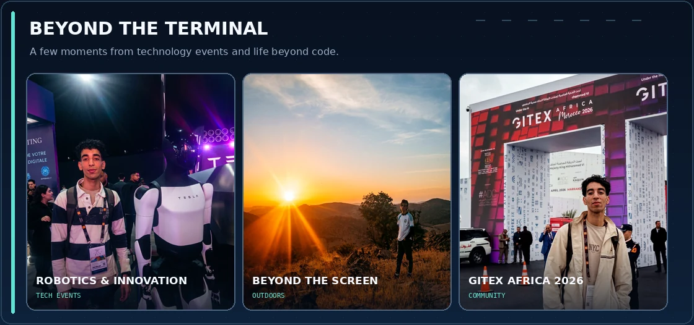

Original photos supplied by me and optimized for the web. Event and nature photography are real; project graphics are illustrations.

<picture><source media="(prefers-reduced-motion: reduce)" srcset="./assets/static/contact.webp" />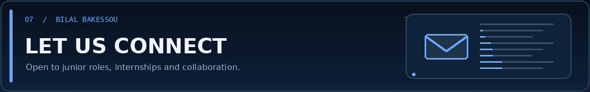</picture>

If you're hiring a **junior full-stack developer**, looking for a **stage pré-embauche**, or have a meaningful project to build, I'd be happy to connect.

  
  
  

  
Built with curiosity and care. · <a href="https://github.com/hisokaBK">github.com/hisokaBK</a>

