<!-- Generated by scripts/build_code_vibe.py. Visual content uses local GIFs; accessible alternatives and independent PNG links are preserved. -->

<picture><source media="(prefers-reduced-motion: reduce)" srcset="./assets/code-vibe/hero.png" />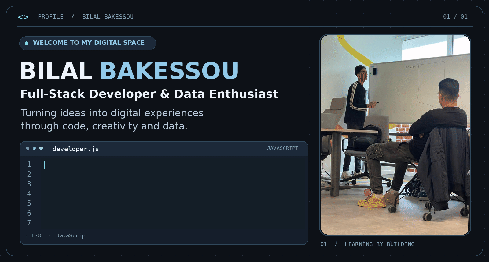</picture>

<a href="https://potfolio-bilal-bakessou.vercel.app/">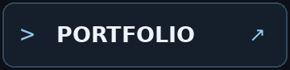</a> &nbsp; <a href="https://www.linkedin.com/in/bilal-bakessou-bs6/">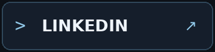</a> &nbsp; <a href="https://github.com/hisokaBK">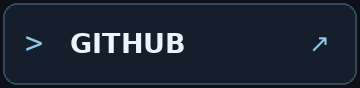</a>

 

<picture><source media="(prefers-reduced-motion: reduce)" srcset="./assets/code-vibe/title-about.png" />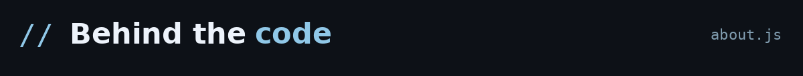</picture>

<picture><source media="(prefers-reduced-motion: reduce)" srcset="./assets/code-vibe/about.png" />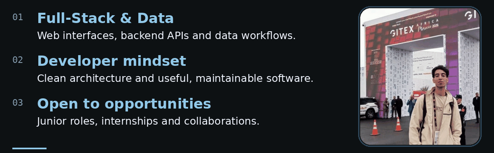</picture>

 

<picture><source media="(prefers-reduced-motion: reduce)" srcset="./assets/code-vibe/title-work.png" />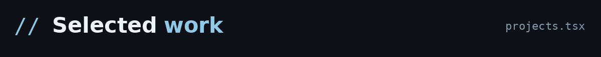</picture>

<picture><source media="(prefers-reduced-motion: reduce)" srcset="./assets/code-vibe/project-pharmaclick.png" />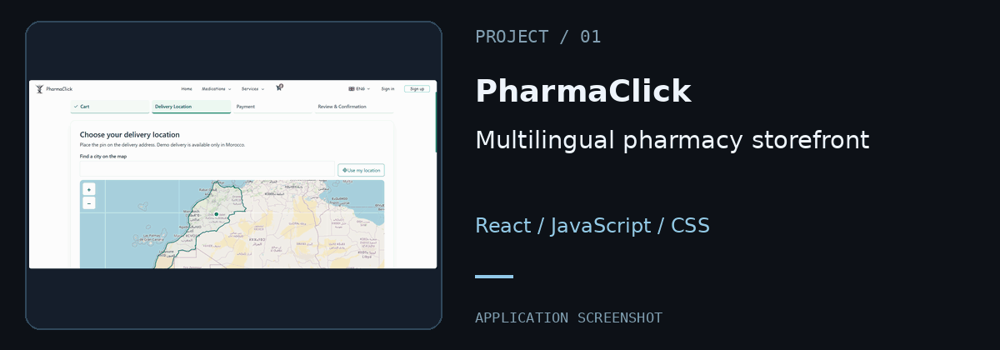</picture>

<a href="https://github.com/hisokaBK/PharmaClick">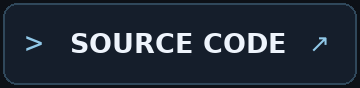</a> &nbsp; <a href="https://pharma-click.netlify.app/">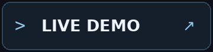</a>

<picture><source media="(prefers-reduced-motion: reduce)" srcset="./assets/code-vibe/project-streaming.png" />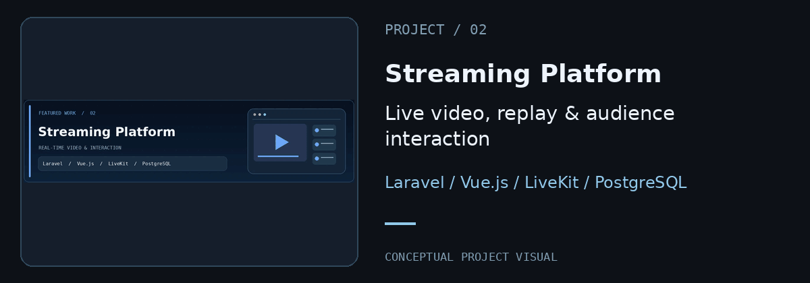</picture>

<picture><source media="(prefers-reduced-motion: reduce)" srcset="./assets/code-vibe/project-ecoshop.png" />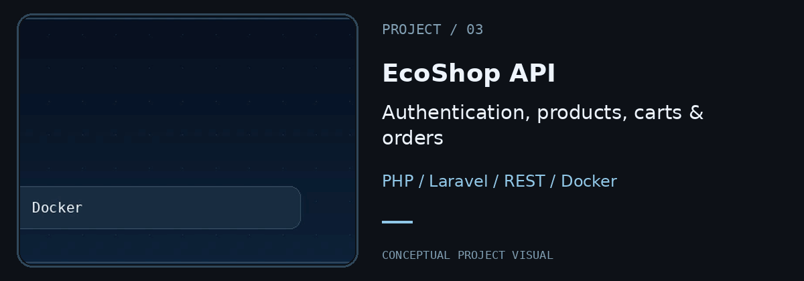</picture>

<picture><source media="(prefers-reduced-motion: reduce)" srcset="./assets/code-vibe/project-weather.png" />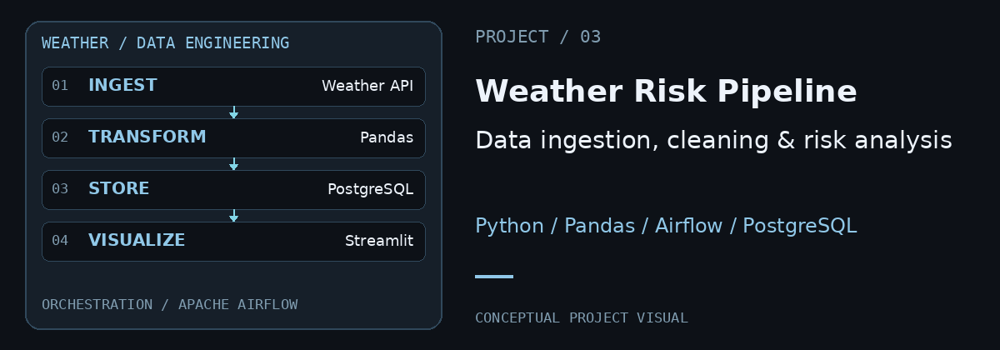</picture>

<picture><source media="(prefers-reduced-motion: reduce)" srcset="./assets/code-vibe/project-easycoloc.png" />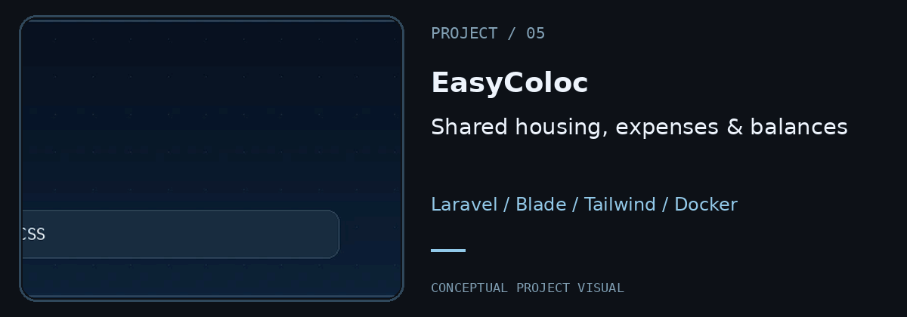</picture>

<picture><source media="(prefers-reduced-motion: reduce)" srcset="./assets/code-vibe/project-orm.png" />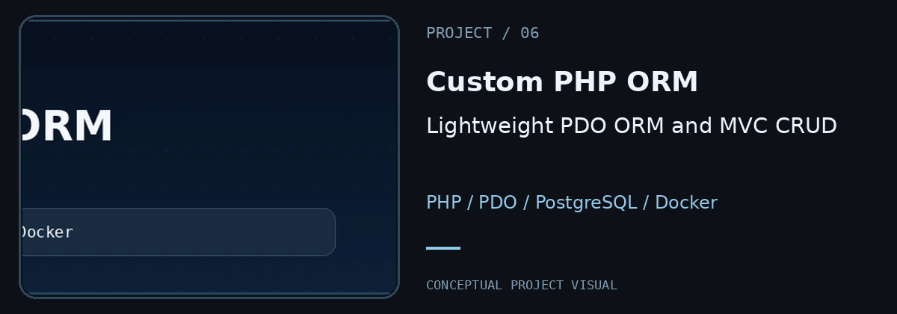</picture>

 

<picture><source media="(prefers-reduced-motion: reduce)" srcset="./assets/code-vibe/title-stack.png" />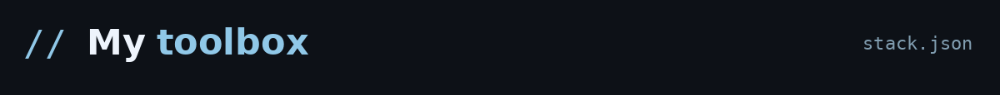</picture>

<picture><source media="(prefers-reduced-motion: reduce)" srcset="./assets/code-vibe/stack.png" />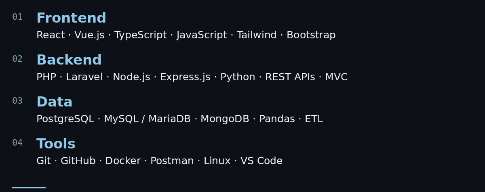</picture>

 

<picture><source media="(prefers-reduced-motion: reduce)" srcset="./assets/code-vibe/title-experience.png" />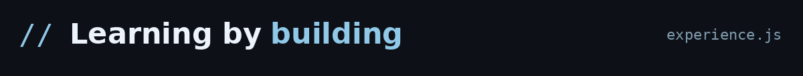</picture>

<picture><source media="(prefers-reduced-motion: reduce)" srcset="./assets/code-vibe/experience.png" />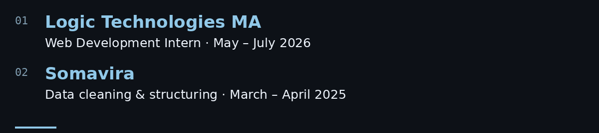</picture>

 

<picture><source media="(prefers-reduced-motion: reduce)" srcset="./assets/code-vibe/title-education.png" />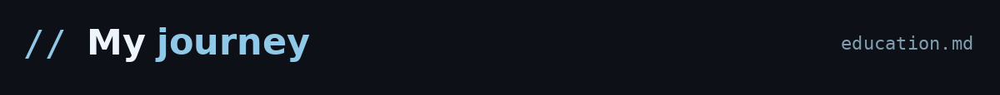</picture>

<picture><source media="(prefers-reduced-motion: reduce)" srcset="./assets/code-vibe/education.png" />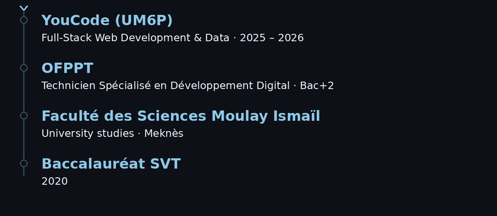</picture>

 

<picture><source media="(prefers-reduced-motion: reduce)" srcset="./assets/code-vibe/title-contact.png" />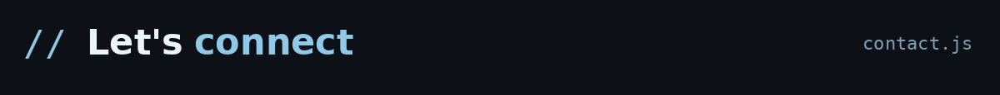</picture>

<picture><source media="(prefers-reduced-motion: reduce)" srcset="./assets/code-vibe/contact.png" />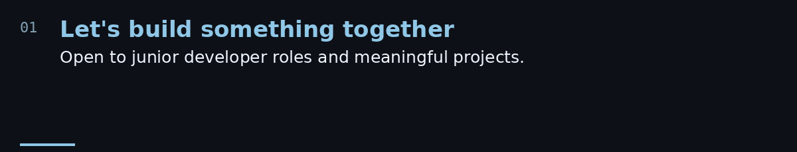</picture>

<a href="mailto:bilalbakessou99@gmail.com">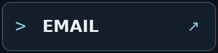</a>

