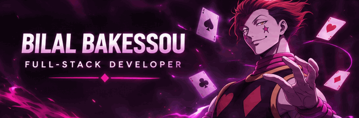
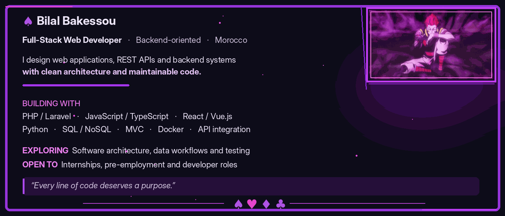
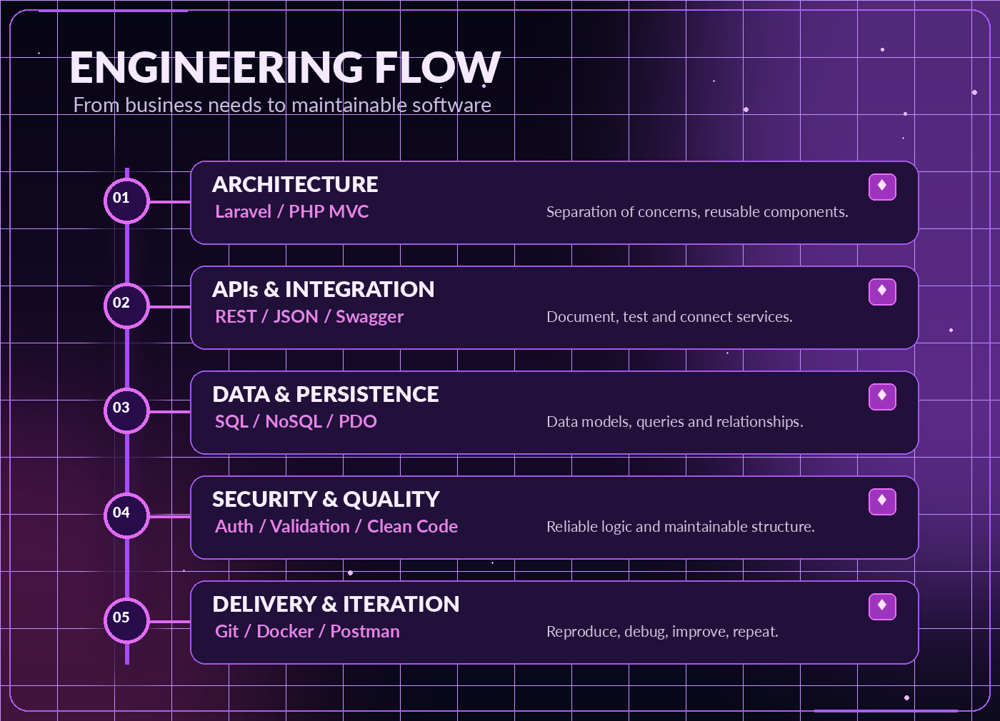
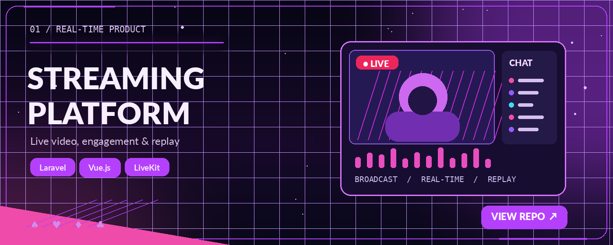

<!--
  BILAL BAKESSOU — HISOKA PROFILE V6 FINAL / CLEAN DARK NEON
  Minimal section titles, cleaner tech stack presentation, and simplified structure.
  Decorative images use picture wrappers as a best-effort non-clickable approach.
  Only project covers and intentional contact links are clickable.
-->

  <picture></picture>

   

  <picture></picture>

   

  <picture></picture>
  <picture></picture>
  <picture></picture>
  
STRATEGY &nbsp;&nbsp; • &nbsp;&nbsp; CREATIVITY &nbsp;&nbsp; • &nbsp;&nbsp; PRECISION &nbsp;&nbsp; • &nbsp;&nbsp; DISCIPLINE

 

  <h2>────────── ABOUT ME ──────────</h2>
  <picture></picture>

  
About Bilal — text version

  **Bilal Bakessou** — Full-Stack Web Developer · Backend-oriented · Morocco.

  I design web applications, REST APIs and backend systems with clean architecture and maintainable code. My work uses PHP / Laravel, JavaScript / TypeScript, React / Vue.js, Python, SQL / NoSQL, MVC, Docker and API integration. I am currently exploring software architecture, data workflows, testing and end-to-end product development.

  *“Every line of code deserves a purpose.”*

  <picture></picture>

 

  <h2>────────── TECH STACK ──────────</h2>
  
Technologies I have worked with across backend, frontend, data, APIs and workflow.

  <h3>Languages &amp; Web Fundamentals</h3>
  <picture></picture>
   

   

  <h3>Frameworks &amp; Frontend</h3>
  <picture></picture>
   

   

  <h3>Databases &amp; Data</h3>
  <picture></picture>
   
   
  <picture></picture>
  <picture></picture>
  <picture></picture>
   
  
   

  <h3>API Design, Documentation &amp; Testing</h3>
  <picture></picture>
  &nbsp;&nbsp;
  <picture></picture>
   
  Postman · Swagger
    
  <picture></picture>
  <picture></picture>
   

   

  <h3>DevOps &amp; Workflow Tools</h3>
  <picture></picture>
   
   
  <picture></picture>
  <picture></picture>
  <picture></picture>
  <picture></picture>
  <picture></picture>
   
  <picture></picture>
   

    
  Also working with: MVC · OOP · PDO · PSR-4 · Git workflows · authentication &amp; authorization · database modeling.

 

  <h2>────────── WHAT I DO ──────────</h2>
  
From architecture and APIs to data, quality and delivery.

  <picture></picture>

 

  <h2>────────── PROJECTS ──────────</h2>
  
<i>Four repositories. Four different engineering challenges. Click any cover to explore the code.</i>

  
    

  
    

  
    

  

 

 
   
  <picture></picture>

 

  <h2>────────── GITHUB STATS ──────────</h2>
  
GitHub overview: repository activity and languages. Live data is provided by third-party widgets.

  <picture></picture>
  <picture></picture>

 

  <h2>────────── CONTACT ──────────</h2>
  
Have a development project, internship or collaboration in mind? Let's connect.

  
  
  
  
  

    
  <picture></picture>
   
  <picture></picture>

