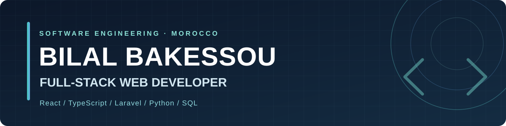

  

  

    <a href="https://potfolio-bilal-bakessou.vercel.app/"><strong>Portfolio</strong></a>
    &nbsp; · &nbsp;
    <a href="https://www.linkedin.com/in/bilal-bakessou-bs6/">LinkedIn</a>
    &nbsp; · &nbsp;
    <a href="mailto:bilalbakessou99@gmail.com">Email</a>
    &nbsp; · &nbsp;
    <a href="https://github.com/hisokaBK?tab=repositories">Repositories</a>
  

---

## About me

I'm **Bilal Bakessou**, a full-stack web developer based in **Morocco**, with an interest in building useful digital products from interface to database.

I work with **React, TypeScript, PHP/Laravel, Python, and SQL**. My projects span responsive web applications, REST APIs, authentication, backend architecture, and data pipelines. I care about understandable code, maintainable structure, and reliable user experiences.

**Currently looking for:** an internship, *stage pré-embauche*, or junior opportunity in **Full-Stack Development, Backend, or Data**. I am mobile for opportunities in **Marrakech and Tangier**.

**Explore my work:** [Personal portfolio](https://potfolio-bilal-bakessou.vercel.app/) · [Featured projects](#featured-projects)

 

## Featured projects

A selection of my work across frontend, backend, and data engineering. Each project links to its source and documentation.

### [01 · PharmaClick](https://github.com/hisokaBK/PharmaClick) — Online pharmacy interface
Responsive React-based pharmacy storefront featuring product discovery and shopping-oriented UI.

**Stack:** React · JavaScript · Bootstrap · Frontend architecture  
[Source code](https://github.com/hisokaBK/PharmaClick) · [Live demo](https://pharma-click.netlify.app/)

### [02 · Streaming Platform](https://github.com/hisokaBK/Streaming_Platform) — Live video and real-time features
Full-stack platform with live streaming, user profiles, interactions, and replay workflows.

**Stack:** Laravel · Vue.js · PostgreSQL · LiveKit · Docker  
[Source code](https://github.com/hisokaBK/Streaming_Platform)

### [03 · EcoShop API](https://github.com/hisokaBK/EcoShop_API) — E-commerce REST API
Backend for authentication, product catalogs, carts, and orders, with role-based protection.

**Stack:** PHP · Laravel · Eloquent · Sanctum · Docker  
[Source code](https://github.com/hisokaBK/EcoShop_API)

### [04 · Weather Risk Pipeline](https://github.com/hisokaBK/pipeline-de-donnees) — Data engineering
Weather-data pipeline for delivery risk analysis, from ingestion and quality checks to database and dashboard.

**Stack:** Python · Pandas · Apache Airflow · PostgreSQL · Streamlit  
[Source code](https://github.com/hisokaBK/pipeline-de-donnees)

### [05 · EasyColoc](https://github.com/hisokaBK/Colocation-EasyColoc) — Shared housing management
Web application for shared-household groups, invitations, expenses, and balances.

**Stack:** Laravel · Blade · Tailwind CSS · Docker  
[Source code](https://github.com/hisokaBK/Colocation-EasyColoc)

### [06 · Custom PHP ORM](https://github.com/hisokaBK/PHP-ORM) — Backend fundamentals
Small MVC/CRUD application demonstrating a lightweight PDO-based ORM in a containerized environment.

**Stack:** PHP · PDO · PostgreSQL · Docker · Nginx  
[Source code](https://github.com/hisokaBK/PHP-ORM)

  
<strong>More work — interactive portfolio website</strong>

  My [developer portfolio](https://github.com/hisokaBK/potfolio) is a separate React/TypeScript application with Tailwind CSS, GSAP, and Three.js. [Visit the live portfolio](https://potfolio-bilal-bakessou.vercel.app/).

## Technical skills

| Focus | Technologies and practices |
| :--- | :--- |
| **Languages** | JavaScript, TypeScript, PHP, Python, SQL, HTML, CSS |
| **Frontend** | React, Vue.js, Tailwind CSS, Bootstrap, responsive interfaces |
| **Backend & APIs** | Laravel, REST APIs, MVC, authentication and authorization, PDO |
| **Databases & data** | PostgreSQL, MySQL/MariaDB, MongoDB, Pandas, data pipelines |
| **Developer tools** | Git, GitHub, Docker, Postman, Linux, VS Code |

## Experience & education

**Web Development Intern · Logic Technologies** — 2026  
Professional internship in web development.

**Full-Stack Web Development & Data · YouCode (UM6P)** — 2025–2026  
Project-based training in web development, backend systems, and data.

**Technicien Spécialisé en Développement Digital · OFPPT** — Bac+2  
Technical training in software and web development.

## Let's connect

I'm interested in collaborating on web applications, backend systems, and data projects, and in joining a team where I can keep growing as a developer.

**[Portfolio](https://potfolio-bilal-bakessou.vercel.app/)** · **[LinkedIn](https://www.linkedin.com/in/bilal-bakessou-bs6/)** · **[Email](mailto:bilalbakessou99@gmail.com)**

Thanks for visiting. This profile focuses on projects, practical skills, and real work.
